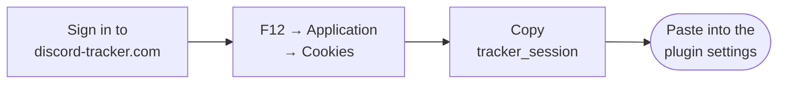

<div align="center">

**English** · [Русский](README.ru.md)

# TrackerLookup

**A one-click profile of any Discord member, with data from [discord-tracker.com](https://discord-tracker.com) right inside the client.**

[](dist/TrackerLookup.plugin.js)
[](https://betterdiscord.app)
[](src)
[](https://github.com/dxvxlery/tracker-lookup/releases/latest)
[](dist/TrackerLookup.plugin.js)

[Features](#features) · [Install](#install) · [Session](#session) · [Updates](#updates) · [Usage](#usage) · [FAQ](#faq)

</div>

---

> [!NOTE]
> The plugin interface is in Russian.

## Features

Right-click a member → **Discord Tracker** to open their profile window. The current voice channel is always shown at the top.

|     | Tab           | What you get                                                                                                                           |
| :-: | ------------- | -------------------------------------------------------------------------------------------------------------------------------------- |
| 🔊  | **Voice now** | The voice channel and server they are in right now and for how long. If they're not in voice, where they were last and when they left. |
| 👤  | **Info**      | Voice activity stats and profile comments.                                                                                             |
| 🏰  | **Servers**   | Servers they spend time on, with roles, sorted by total time, first or last time.                                                      |
| 🤝  | **Friends**   | People they sit with in voice, with the same sorting.                                                                                  |
| 🕒  | **Events**    | Voice events: mic, sound, stream, camera, joins and leaves.                                                                            |
| 🏷️  | **Nicknames** | Nickname history.                                                                                                                      |
| 💬  | **Messages**  | Deleted and edited messages, and mentions.                                                                                             |

<details>
<summary><b>Also</b></summary>

- Comments work without signing in.
- Responses are cached in memory for a few minutes, so reopening a profile is instant. Nothing from the site is written to disk.
- You can jump from a friend to their profile and back.
- If the site returns something unexpected, only that tab breaks — the rest of the window keeps working.
- It updates itself and shows what's new after an update.

</details>

## Install

> [!IMPORTANT]
> You need [BetterDiscord](https://betterdiscord.app) installed. For everything except comments you also need a discord-tracker.com account.

1. Download `TrackerLookup.plugin.js` from the [latest release](https://github.com/dxvxlery/tracker-lookup/releases/latest).
2. Open Settings → **BetterDiscord** → **Plugins** → **Open Plugins Folder** and drop the file there.
3. Enable **TrackerLookup** in the list.

## Session

The site shows comments to everyone. Everything else needs a single cookie, `tracker_session`, from the browser you're signed in with.



1. Sign in to discord-tracker.com in your browser.
2. Press <kbd>F12</kbd> → **Application** → **Cookies** → `discord-tracker.com`.
3. Double-click the `tracker_session` value and press <kbd>Ctrl</kbd>+<kbd>C</kbd>.
4. Open the plugin settings (gear icon), paste it and press **Сохранить** (Save).

> [!TIP]
> You can also paste a whole **Copy as cURL** of any request to the site — the plugin finds the cookie in it.

Then press **Проверить** (Check): the plugin makes a test request and tells you whether the session works.

## Updates

The plugin checks for a new version 15 seconds after Discord starts and then every 6 hours, and asks before installing it. You can also press **Проверить обновления** (Check for updates) in the **Обновления** (Updates) section of the settings, or turn automatic checks off there. Every release is listed on the [releases page](https://github.com/dxvxlery/tracker-lookup/releases) and in the [changelog](CHANGELOG.md).

## Usage

- **Open a profile:** right-click a member in a server or DM → **Discord Tracker**.
- **Sort servers or friends:** the dropdown above the list.
- **Friend's profile:** click a person in the **Знакомые** (Friends) tab.
- **Open on the site:** the arrow button in the window header.
- **Close:** <kbd>Esc</kbd> or click outside the window.

## FAQ

<details>
<summary><b>Only comments are shown</b></summary>

The plugin has no `tracker_session` or it has expired. Copy it again from the browser and save it in the settings.

</details>

<details>
<summary><b>No "Discord Tracker" item in the menu</b></summary>

Make sure the plugin is enabled and reload Discord (<kbd>Ctrl</kbd>+<kbd>R</kbd>).

</details>

<details>
<summary><b>Where is the session stored?</b></summary>

Only on your machine, in the BetterDiscord plugins folder. It is sent only to discord-tracker.com.

</details>

> [!CAUTION]
> Never share `TrackerLookup.config.json`: the `tracker_session` in it gives access to your account on the site.

<details>
<summary><b>Building from source</b></summary>

```powershell
docker run --rm -v "${PWD}:/app" -v tracker-bd-nm:/app/node_modules -w /app node:22 sh -c "npm ci && npm run check"
```

The built file ends up in `dist/`.

</details>

<details>
<summary><b>Making a release</b></summary>

1. Bump `version` in `package.json` and add an entry to the top of `src/releases.ts` (Russian) and `src/release-notes.ts` (English).
2. Run the build above and commit `dist/`, `CHANGELOG.md` and the READMEs.
3. Push a tag `vX.Y.Z`. GitHub Actions checks the build and publishes the release with the plugin file attached.

Installed plugins pick the update up from `main`.

</details>

---

<div align="center"><sub>Data comes from discord-tracker.com. This plugin is not affiliated with the site.</sub></div>
