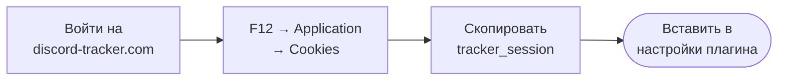

<div align="center">

[English](README.md) · **Русский**

# TrackerLookup

**Досье на участника Discord в один клик: данные с [discord-tracker.com](https://discord-tracker.com) прямо в клиенте.**

[](dist/TrackerLookup.plugin.js)
[](https://betterdiscord.app)
[](src)
[](https://github.com/dxvxlery/tracker-lookup/releases/latest)
[](dist/TrackerLookup.plugin.js)

[Возможности](#возможности) · [Установка](#установка) · [Сессия](#сессия) · [Обновления](#обновления) · [Использование](#использование) · [Вопросы](#вопросы)

</div>

---

## Возможности

Правый клик по участнику → **Discord Tracker**, и открывается окно профиля. Сверху всегда видно, где человек сидит в войсе прямо сейчас.

|     | Вкладка        | Что показывает                                                                                                           |
| :-: | -------------- | ------------------------------------------------------------------------------------------------------------------------ |
| 🔊  | **Где сейчас** | В каком канале и на каком сервере человек сидит сейчас и сколько. Если не в войсе — где был последний раз и когда вышел. |
| 👤  | **Инфо**       | Статистика голосовой активности и комментарии о человеке.                                                                |
| 🏰  | **Серверы**    | На каких серверах проводит время, с ролями, сортировка по общему времени, первому или последнему разу.                   |
| 🤝  | **Знакомые**   | С кем сидит в войсе, с той же сортировкой.                                                                               |
| 🕒  | **События**    | Голосовые события: микрофон, звук, стрим, камера, входы и выходы.                                                        |
| 🏷️  | **Ники**       | История ников.                                                                                                           |
| 💬  | **Сообщения**  | Удалённые и изменённые сообщения, упоминания.                                                                            |

<details>
<summary><b>А ещё</b></summary>

- Комментарии работают без входа на сайт.
- Ответы несколько минут хранятся в памяти, так что повторное открытие профиля мгновенное. На диск с сайта ничего не пишется.
- Из знакомых можно перейти в профиль человека и вернуться назад.
- Если сайт ответил чем-то странным, ломается только одна вкладка, остальное окно работает.
- Плагин обновляется сам и после обновления показывает, что нового.

</details>

## Установка

> [!IMPORTANT]
> Нужен установленный [BetterDiscord](https://betterdiscord.app). Для всего, кроме комментариев, — ещё и аккаунт на discord-tracker.com.

1. Скачай `TrackerLookup.plugin.js` из [последнего релиза](https://github.com/dxvxlery/tracker-lookup/releases/latest).
2. Открой Настройки → **BetterDiscord** → **Плагины** → **Открыть папку плагинов** и положи туда файл.
3. Включи **TrackerLookup** в списке.

## Сессия

Комментарии сайт показывает всем. Для остального нужна одна cookie — `tracker_session` из браузера, где ты вошёл на сайт.



1. Войди на discord-tracker.com в браузере.
2. Нажми <kbd>F12</kbd> → **Application** → **Cookies** → `discord-tracker.com`.
3. Дважды кликни по значению `tracker_session` и нажми <kbd>Ctrl</kbd>+<kbd>C</kbd>.
4. Открой настройки плагина (шестерёнка), вставь значение и нажми **Сохранить**.

> [!TIP]
> Можно вставить и целиком **Copy as cURL** любого запроса сайта — плагин сам найдёт в нём cookie.

После этого нажми **Проверить**: плагин сделает пробный запрос и скажет, работает ли сессия.

## Обновления

Плагин проверяет новую версию через 15 секунд после запуска Discord и затем раз в 6 часов, а перед установкой спрашивает. Проверить вручную или выключить автопроверку можно в настройках, раздел «Обновления». Все релизы есть на [странице релизов](https://github.com/dxvxlery/tracker-lookup/releases) и в [списке изменений](CHANGELOG.md) (на английском).

## Использование

- **Открыть профиль:** правый клик по участнику на сервере или в ЛС → **Discord Tracker**.
- **Сортировка серверов и знакомых:** выпадающий список над списком.
- **Профиль знакомого:** клик по человеку во вкладке «Знакомые».
- **Открыть на сайте:** кнопка со стрелкой в шапке окна.
- **Закрыть:** <kbd>Esc</kbd> или клик мимо окна.

## Вопросы

<details>
<summary><b>Видны только комментарии</b></summary>

В плагине нет `tracker_session` или она истекла. Скопируй её заново из браузера и сохрани в настройках.

</details>

<details>
<summary><b>Не видно пункта «Discord Tracker»</b></summary>

Проверь, что плагин включён, и перезапусти Discord (<kbd>Ctrl</kbd>+<kbd>R</kbd>).

</details>

<details>
<summary><b>Где хранится сессия</b></summary>

Только у тебя, в папке плагинов BetterDiscord. Отправляется она только на discord-tracker.com.

</details>

> [!CAUTION]
> Не пересылай никому файл `TrackerLookup.config.json`: по `tracker_session` можно войти в твой аккаунт на сайте.

<details>
<summary><b>Сборка из исходников</b></summary>

```powershell
docker run --rm -v "${PWD}:/app" -v tracker-bd-nm:/app/node_modules -w /app node:22 sh -c "npm ci && npm run check"
```

Готовый файл появится в `dist/`.

</details>

<details>
<summary><b>Как выпустить релиз</b></summary>

1. Подними `version` в `package.json` и добавь запись наверх `src/releases.ts` (русский) и `src/release-notes.ts` (английский).
2. Запусти сборку выше и закоммить `dist/`, `CHANGELOG.md` и README.
3. Запушь тег `vX.Y.Z`. GitHub Actions проверит сборку и опубликует релиз с файлом плагина.

Установленные плагины подхватят обновление из `main`.

</details>

---

<div align="center"><sub>Данные берутся с discord-tracker.com, плагин с сайтом не связан.</sub></div>
